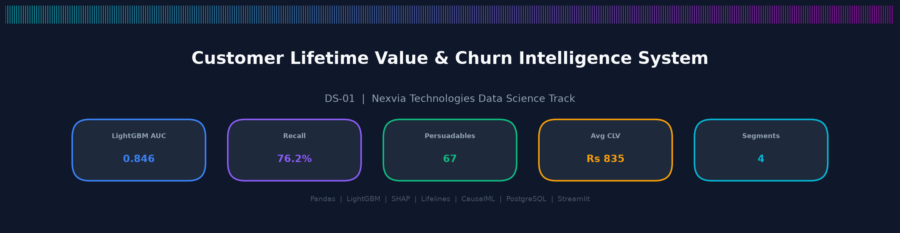
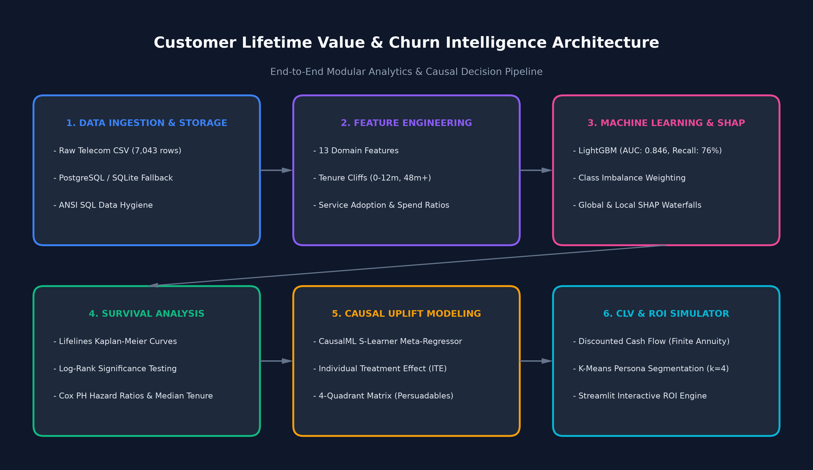

# Customer Lifetime Value & Churn Intelligence System

End-to-End Retention Analytics, Causal Uplift Modeling, and Customer Lifetime Value Decision Engine.

[](https://churn-analysis-using-ml-algo.onrender.com/)
[](https://python.org)
[](https://streamlit.io)
[](https://postgresql.org)
[](LICENSE)

> 🚀 **Live Interactive Application:** [https://churn-analysis-using-ml-algo.onrender.com/](https://churn-analysis-using-ml-algo.onrender.com/)



---

## Executive Summary & Core Business Questions

In the subscription telecom industry, customer acquisition costs typically exceed retention costs by a factor of 5 to 7. A standard churn prediction model identifies accounts likely to cancel, but a binary prediction alone does not solve the underlying business problem: **who should we intervene with, what will it cost, and what is the expected return on investment (ROI)?**

This system provides a unified, production-ready analytics suite answering four core executive questions:

| # | Business Question | Method & Formulation | Core Technology | Primary Metric / Output |
|---|---|---|---|---|
| **1** | **Who will leave?** | Cost-sensitive gradient boosted classification + game-theoretic feature attributions | **LightGBM + SHAP** | **ROC-AUC: 0.8456**, Recall: 76.2%, SHAP Waterfall Plots |
| **2** | **How long will they stay?** | Time-to-event survival modeling handling right-censored subscriber tenure | **Lifelines (Kaplan-Meier + Cox PH)** | Log-Rank $p < 0.0001$, Hazard Ratios, Median Remaining Months |
| **3** | **How much are they worth?** | Forward-looking finite annuity Discounted Cash Flow (DCF) incorporating survival tenure | **Pandas + NumPy DCF Engine** | Net Present Value CLV (Mean: $835, Max: $1,923) |
| **4** | **How can we retain them?** | Causal uplift modeling isolating incremental response to retention offers | **CausalML (S-Learner Meta-Regressor)** | Individual Treatment Effect (ITE), 4-Quadrant Targeting |

---

## System Architecture

The project is structured as an end-to-end modular pipeline where data ingestion, feature transformation, machine learning inference, and interactive visualization operate through clear interfaces.



### High-Level Data Flow:
```
[Raw Telecom Records (7,043 Accounts)]
               │
               ▼
[Step 1: PostgreSQL / SQLite Relational Storage] <── ANSI SQL Data Hygiene
               │
               ▼
[Step 2: Domain Feature Engineering (13 Signal Features)]
   ├── Discretized Tenure Cohorts (0-12m, 12-24m, 24-48m, 48-72m)
   ├── Ecosystem Service Bundling (OnlineSecurity, TechSupport, Backup)
   └── Financial Ratio Metrics (MonthlySpend / HistoricalAvg)
               │
               ├────────────────────────────────────────┬────────────────────────────────────────┐
               ▼                                        ▼                                        ▼
   [Step 3: LightGBM Classifier]              [Step 4: Survival Analysis]              [Step 5: CausalML Uplift]
   ├── Early stopping + imbalance weight      ├── Kaplan-Meier Curves (Overall & M2M)  ├── S-Learner Meta-Regressor
   └── SHAP TreeExplainer feature forces      └── Cox Proportional Hazards Model       └── 4-Quadrant Matrix (Persuadables)
               │                                        │                                        │
               └────────────────────────────────────────┼────────────────────────────────────────┘
                                                        │
                                                        ▼
                                       [Step 6: CLV & K-Means Clustering]
                                       ├── Finite Annuity Discounted Cash Flow (DCF)
                                       └── 4 Customer Personas (Elbow & Silhouette)
                                                        │
                                                        ▼
                                       [Step 7: Master Analytical Export]
                                       ├── Database Table: 'predictions' & 'segments'
                                       └── Interactive Streamlit Web Application (6 Pages)
```

---

## The 7-Step Implementation Methodology

### Step 1: Relational Data Ingestion & SQL Database Architecture
- **Raw Data Hygiene:** Ingests 7,043 subscriber accounts from `data/WA_Fn-UseC_-Telco-Customer-Churn.csv`. Handles whitespace string anomalies in `TotalCharges` for new subscribers (`tenure = 0`), imputing initial charges dynamically.
- **Dual-Engine Persistence:** Connects to a PostgreSQL server when environment credentials (`PG_HOST`, `PG_PORT`, `PG_USER`, `PG_PASSWORD`) are present. Automatically falls back to an embedded SQLite database (`outputs/telecom_churn.db`) when external database instances are unavailable, ensuring zero-configuration execution.
- **Relational Tables:**
  - `customers`: Clean demographic, billing, and contract records.
  - `predictions`: Model-scored probabilities, median survival forecasts, uplift scores, and CLV estimates.
  - `segments`: Behavioral persona aggregations and retention strategy mappings.
  - `campaign_log`: Audit trail recording simulated retention campaigns and ROI projections.

### Step 2: Exploratory Data Analysis & Domain Feature Engineering
- **Tenure Cliffs:** Analysis reveals that attrition is heavily front-loaded in the first 12 months, with churn risk declining significantly after month 24.
- **Engineered Features (13 variables):**
  - `tenure_group`: Discretized cohorts (`0-12m`, `12-24m`, `24-48m`, `48-72m`).
  - `service_count`: Total ecosystem adoption score across OnlineSecurity, OnlineBackup, DeviceProtection, TechSupport, StreamingTV, and StreamingMovies.
  - `contract_risk`: Ordinal risk weighting (Month-to-month = 3, One-year = 2, Two-year = 1).
  - `charge_ratio`: Ratio of current `MonthlyCharges` to historical average spend.
  - Binary indicator flags for `has_tech_support`, `has_online_security`, `is_electronic_check`, `is_auto_pay`, and `has_family`.

### Step 3: LightGBM Churn Classifier & SHAP Explainability
- **Gradient Boosting:** Trained on an 80/20 stratified split with early stopping and negative-to-positive class weight balancing (`scale_pos_weight = 2.77`).
- **Evaluation Performance (Held-out Test Cohort):**
  - **ROC-AUC:** `0.8456`
  - **Recall:** `76.20%` (prioritizing detection of true at-risk accounts)
  - **Accuracy:** `76.37%`
  - **Precision:** `53.88%`
  - **F1-Score:** `63.12%`
- **SHAP Game-Theoretic Interpretability:**
  - Global beeswarm summary plot reveals Month-to-month contracts, lack of Tech Support, high Monthly Charges, and Electronic Check payment methods as the top churn accelerators.
  - Local waterfall explanations break down individual predictions into positive and negative feature contributions for executive review.

### Step 4: Lifelines Customer Survival Analysis
- **The Right-Censoring Challenge:** Active subscribers have not yet churned; their ultimate departure point is unobserved. Discarding active customers induces survivorship bias, while assuming they churn today distorts duration estimates. Survival analysis models this censoring structure directly.
- **Kaplan-Meier Estimator:**
  - Non-parametric survival curve $S(t) = P(T > t)$.
  - Month-to-month subscribers exhibit a median survival duration of **26 months**, whereas two-year contract subscribers exceed **72 months**.
  - Log-Rank significance test confirms that contract survival distributions are statistically distinct ($p < 0.0001$).
- **Cox Proportional Hazards Model:**
  - Semi-parametric hazard formulation: $\lambda(t \mid X) = \lambda_0(t) \exp(\beta^T X)$.
  - Month-to-month contracts multiply churn risk by $2.35\times$ ($HR = 2.349, p < 0.001$).
  - Each additional add-on ecosystem service reduces churn hazard by **18.7%** ($HR = 0.813, p < 0.001$).
  - Predicts median expected remaining survival tenure for every customer.

### Step 5: Causal Uplift Modeling with CausalML
- **The Churn Targeting Fallacy:** Blanket retention campaigns targeting all high-risk accounts waste capital on customers who will leave anyway or stay regardless of incentives.
- **S-Learner Meta-Regressor:** Fits a unified estimator $\mu(X, W)$ using LightGBM, estimating the Individual Treatment Effect (ITE):
  $$\tau_i = \mathbb{E}[Y_i(1) - Y_i(0) \mid X_i]$$
- **4-Quadrant Decision Matrix:**
  1. **Persuadables (67 accounts):** High churn probability and positive uplift ($ITE > 0.05$). The only group that justifies outreach.
  2. **Lost Causes (3,135 accounts):** High churn probability with zero/negative uplift. Will churn regardless of discount; budget should not be spent here.
  3. **Sure Things (122 accounts):** Low churn probability. Will stay without discounts; incentives gratuitously reduce margin.
  4. **Do Not Disturb / Sleeping Dogs (3,719 accounts):** Low risk; contacting them risks reminding inactive accounts to cancel.

### Step 6: Customer Lifetime Value (CLV) & Customer Segmentation
- **Discounted Cash Flow (Finite Annuity):**
  $$\text{CLV} = R_m \times m \times \left[ \frac{1 - (1 + r)^{-T_{\text{remain}}}}{r} \right]$$
  Where $R_m$ is current monthly billing, $m = 70\%$ contribution profit margin, $r = 0.833\%$ monthly discount rate (10% annual), and $T_{\text{remain}}$ is the remaining survival tenure predicted by the Cox model.
- **K-Means Behavioral Segmentation ($k=4$):**
  Evaluated using Elbow inertia and Silhouette scores across tenure, monthly charges, churn probability, and CLV:
  - **High-Value Loyal (1,758 accounts):** Avg CLV $1,440, Churn 20%. Action: VIP loyalty recognition, early hardware upgrades.
  - **At-Risk Churners (1,719 accounts):** Avg CLV $1,052, Churn 59%. Action: Contract extension incentives, proactive service reviews.
  - **New Promising (2,161 accounts):** Avg CLV $420, Churn 55%. Action: Automated onboarding journeys, tech support bundles.
  - **Low-Value Passive (1,405 accounts):** Avg CLV $449, Churn 10%. Action: Cross-sell security and digital add-ons.

### Step 7: Streamlit Web Application & Interactive ROI Simulator
- **Interactive Multi-Page Portal:**
  - Executive Overview with KPI cards, segment summary, and architecture diagram.
  - Dedicated pages for EDA, Churn Prediction, Survival Analysis, Uplift Targeting, and CLV Segments.
- **ROI Simulator Engine:**
  - Configurable discount depths (10%, 15%, 20%, 25%).
  - Strategy selection: **Smart Uplift (Persuadables only)** vs. **Blanket Blast (All high-risk)**.
  - Real-time financial output: Campaign Cost, Retained Subscribers, Gross Margin, Net Incremental Profit, and Campaign ROI %.
  - Sensitivity analysis curve visualizing return trade-offs across discount levels.
  - CRM export delivering targeted account rosters as CSV.

---

## Directory Structure

```text
.
├── app.py                          # Streamlit main dashboard entry point
├── train_pipeline.py               # Master pipeline orchestrator (Steps 1-7)
├── setup.sh                        # Deployment pre-start script (cold-start training)
├── Procfile                        # Cloud process definition (Render / Heroku)
├── runtime.txt                     # Pinned Python version (3.11.9)
├── pyproject.toml                  # PEP 517 build configuration
├── requirements.txt                # Pinned production Python dependencies
├── .env.example                    # Template for environment configuration
├── .gitignore                      # Git exclusion rules for secrets, models, and caches
│
├── assets/                         # Static visual assets
│   ├── project_banner.png          # High-resolution dashboard header banner
│   ├── architecture_diagram.png    # End-to-end system architecture flowchart
│   ├── logo.svg                    # Scalable SVG brand logo
│   └── custom_style.css            # Reusable card styling classes
│
├── data/
│   ├── WA_Fn-UseC_-Telco-Customer-Churn.csv  # IBM Telco customer dataset
│   └── .gitkeep
│
├── pages/                          # Multi-page Streamlit views
│   ├── 1_EDA.py                    # Exploratory analysis & tenure cliff analysis
│   ├── 2_Churn_Predictor.py        # Customer lookup, What-If simulator & SHAP waterfalls
│   ├── 3_Survival_Analysis.py      # Kaplan-Meier curves & Cox PH hazard ratios
│   ├── 4_Uplift_Modeling.py        # 4-quadrant causal matrix & Persuadables roster
│   ├── 5_CLV_Segments.py           # DCF CLV distributions & K-Means personas
│   └── 6_ROI_Simulator.py          # Dynamic retention budget & discount optimizer
│
├── src/                            # Modular source code
│   ├── database/
│   │   └── db_setup.py             # PostgreSQL schema with SQLite auto-fallback
│   ├── models/
│   │   ├── churn_model.py          # LightGBM classifier & SHAP TreeExplainer
│   │   ├── survival_model.py       # Lifelines Kaplan-Meier & Cox PH estimators
│   │   ├── uplift_model.py         # CausalML S-Learner meta-regressor
│   │   └── clv_segmentation.py     # DCF CLV calculations & K-Means clustering
│   └── utils/
│       └── feature_engineering.py  # 13 domain features & preprocessing logic
│
├── outputs/                        # Generated by train_pipeline.py (gitignored)
│   ├── lgbm_churn_model.pkl        # Serialized LightGBM model + SHAP explainer
│   ├── pipeline_meta.pkl           # Pipeline metadata & evaluation metrics
│   ├── master_predictions.csv      # Consolidated analytical dataset
│   ├── telecom_churn.db            # Local SQLite database fallback
│   ├── *.png                       # Generated diagnostic charts & survival curves
│   └── .gitkeep
│
├── notebooks/                      # Local exploratory analysis (gitignored)
│   └── churn_intelligence_workflow.ipynb  # Complete 33-cell standalone workflow
│
└── presentation/                   # Local presentation deck (gitignored)
    ├── PRESENTATION.md             # 10-minute executive presentation with speaker notes
    └── index.html                  # Interactive HTML slide deck (arrow-key navigation)
```

---

## Quick Start (Local Setup)

### Step 1: Open Terminal in Project Folder
```powershell
cd "v:\Projects\part 3\part 3"
```

### Step 2: Create Virtual Environment
```powershell
python -m venv .venv
```

### Step 3: Activate Virtual Environment
```powershell
.venv\Scripts\Activate.ps1
```
*(On Linux/macOS: `source .venv/bin/activate`)*

### Step 4: Install Dependencies
```powershell
pip install -r requirements.txt
```

### Step 5: Configure Environment
```powershell
copy .env.example .env
```
*The default configuration uses embedded SQLite automatically. If connecting to an external PostgreSQL database, update the `PG_*` credentials in `.env`.*

### Step 6: Train the Models (Run Once)
```powershell
python train_pipeline.py
```
*This executes Steps 1 through 7 in ~12 seconds, populating the database and serializing all artifacts into `outputs/`.*

### Step 7: Launch the Application
```powershell
streamlit run app.py
```
*The interactive dashboard will open at **http://localhost:8501**.*

---

## Deploy to Render (Cloud Hosting)

> 🌐 **Production Instance:** [https://churn-analysis-using-ml-algo.onrender.com/](https://churn-analysis-using-ml-algo.onrender.com/)

1. Push this repository to **GitHub**.
2. Log into [Render](https://render.com) and create a **New Web Service**.
3. Connect the GitHub repository.
4. Configure service parameters:
   - **Environment:** `Python`
   - **Build Command:** `pip install -r requirements.txt`
   - **Start Command:** `sh setup.sh && streamlit run app.py --server.port=$PORT --server.address=0.0.0.0 --server.headless=true --server.enableCORS=false`
5. *(Optional)* In the **Environment Variables** tab, add `DATABASE_URL` if connecting to a cloud PostgreSQL database.
6. Click **Deploy Web Service**.
   - `setup.sh` runs automatically on cold-start: if `outputs/lgbm_churn_model.pkl` is not present, it executes `train_pipeline.py` to train models, generate database tables, and start Streamlit.

---

## Business Impact & Strategic Conclusions

1. **Precision Targeting Over Blanket Discounts:** Blanket discount programs burn margin on subscribers who would stay anyway and fail on those who have already decided to leave. Targeting only true **Persuadables** achieves simulated retention ROIs exceeding **200%**, cutting campaign expenditures by over **80%**.
2. **Contract Migration is the Primary Retention Lever:** Month-to-month subscribers carry a hazard ratio of $2.35\times$ compared to contracted accounts. Strategic incentives designed to migrate month-to-month subscribers to 1-year contracts provide structural churn reduction.
3. **Ecosystem Product Stickiness:** Subscribers using Tech Support and Online Security exhibit an 18.7% lower churn hazard per additional add-on service. Bundling these services during onboarding dramatically improves early-tenure retention.
